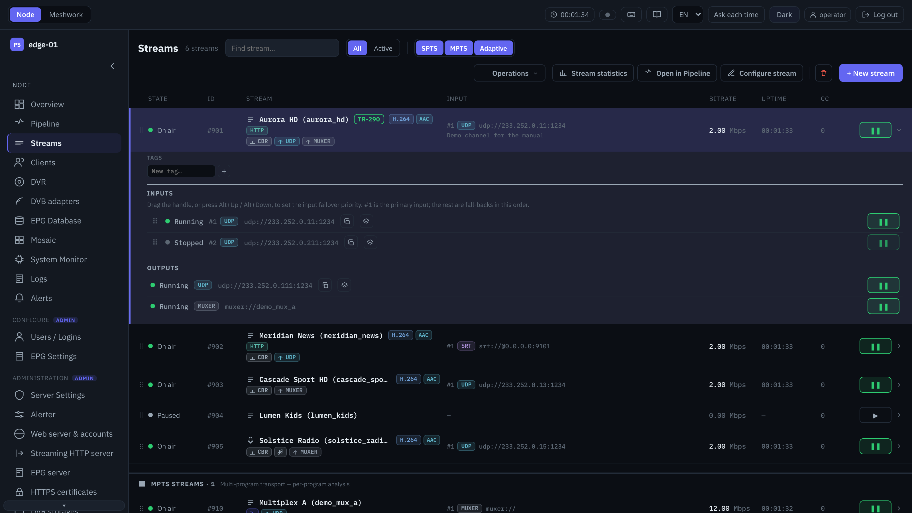
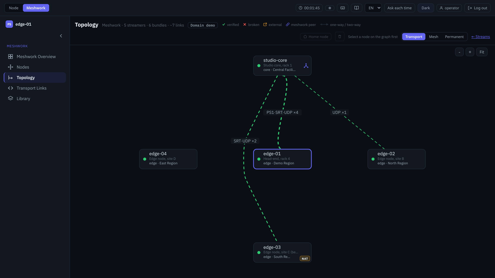
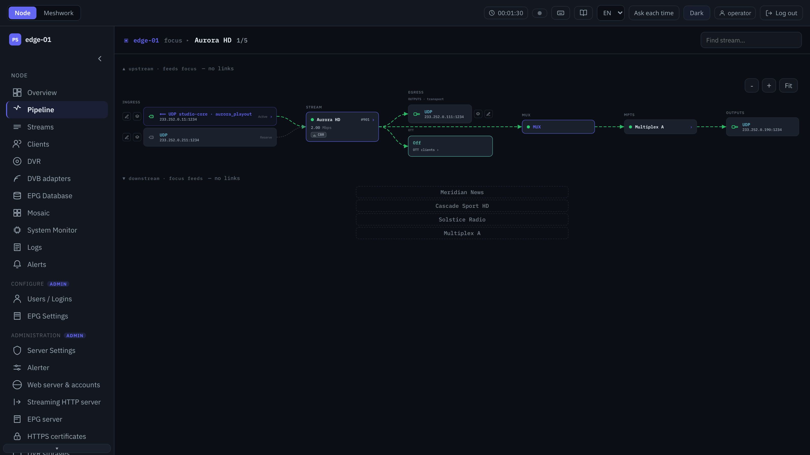
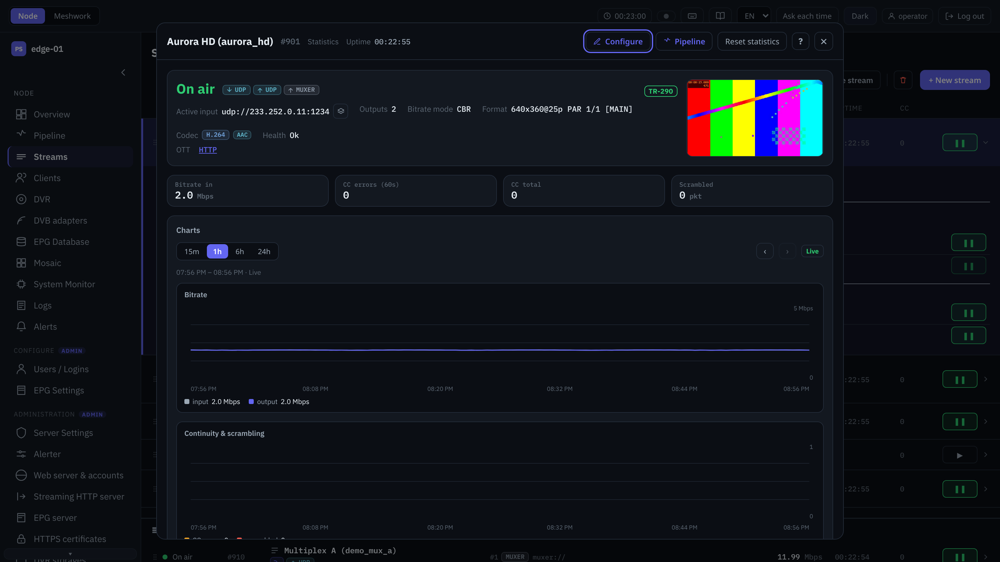
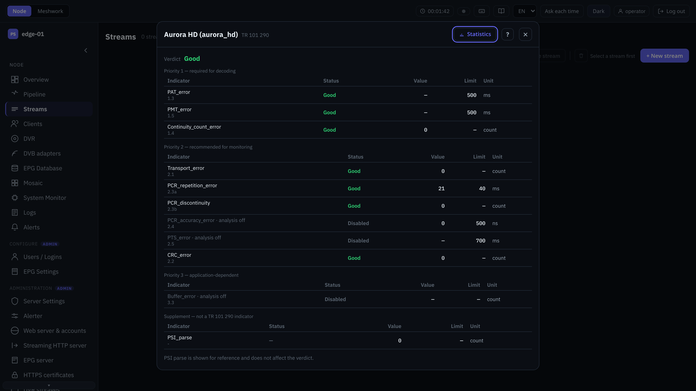

# Perfect Streamer — IPTV / OTT streaming server for broadcast delivery

**Perfect Streamer®** is professional software for delivering TV channels over the public Internet and IP networks:
SRT, RIST, Pro-MPEG FEC, UDP/RTP multicast, HLS / DASH, and the proprietary **Perfect Stream (PS1)** protocol for reliable
point-to-point delivery without expensive dedicated links. It runs on Linux (RHEL / AlmaLinux and Debian / Ubuntu) and is
managed from a web UI and an HTTP API.

[Website](https://meshwork.pstreamer.tv) · [Documentation](https://doc2.pstreamer.tv/en/) · [Download the demo](https://github.com/perfect-soft/perfect-streamer/releases/tag/v1.11.1) · [Help Center](https://support.pstreamer.tv/) · [Pre-sales & purchase](https://support.pstreamer.tv/crm/support/new/purchase) · [Support](mailto:support@pstreamer.tv)



## Features

- **Transport protocols:** Perfect Stream (PS1), SRT (caller / listener / rendezvous, AES), RIST, Pro-MPEG FEC,
  UDP / RTP unicast and multicast (IGMP v3 SSM), TCP, HTTP, HLS and RTSP input.
- **Stream reliability:** input failover with backup sources, jitter elimination and stream synchronization,
  PCR correction and restamping.
- **MPEG-TS processing:** MPTS multiplexer and demultiplexer (T-STD / TR 101 290 compliant), PID remapping,
  metadata (PSI/SI) modification, EIT generator, EPG server (XMLTV), AES encryption, mosaic.
- **Analysis and monitoring:** real-time TR 101 290 analyzer, per-PID bitrate statistics, charts, alerts;
  Zabbix, Prometheus, Telegraf / InfluxDB and Grafana integration.
- **DVB:** DVB-S/S2, DVB-C, DVB-T/T2 cards and ASI devices, DVB scanner, BISS-1 / BISS-E descrambling, multi-stream T2-MI.
- **OTT:** HLS, MPEG-DASH, WebVTT subtitles from teletext.
- **Transcoding:** NVIDIA NVENC, Intel VPL and software (CPU) transcoders as separate packages.

The current version, **Perfect Streamer Meshwork** (2.x), adds Meshwork clustering (streamers managed from one UI), Low-Latency HLS / DASH on CMAF, DVR / timeshift,
and a new web UI.

<table>
  <tr>
    <td></td>
    <td></td>
  </tr>
  <tr>
    <td></td>
    <td></td>
  </tr>
</table>

*Screenshots: Perfect Streamer Meshwork web UI.*

## New: Perfect Streamer Meshwork 2.1 beta

Version **2.1** is out as a public **beta** (2.1.0.469) in a separate beta channel of the package repository; the stable
2.0.2 stays where it is. The beta is for licensed (protected) installations; 2.x licences work on it.

- **Meshwork reserve for multicast outputs:** UDP, RTP and Pro-MPEG outputs of several streamers form one reserve group;
  one node sends, and if its node, input or output fails another node takes over on the common timeline, without a gap
  or a duplicate at the receivers.
- **OTT / DVR reserve for viewers:** an HLS viewer whose node fails keeps watching from another node of the group
  (Safari / iOS / tvOS, hls.js in browsers, ExoPlayer / Media3); a new viewer of a failed stream and a catch-up request for
  a period this node has not recorded are redirected to a node that can serve them.
- **SMPTE ST 2022-7:** RTP and Pro-MPEG inputs take one stream over two network paths and merge them packet by packet.
- **SMPTE ST 2022-1 FEC:** standard Pro-MPEG FEC on inputs and outputs, with a FEC wait limit and counters.
- **Reserve events and charts:** every reserve switch is in the stream's event log and on its statistics charts.
- **TR 101 290:** stricter sync-byte and PCR checks.

[What's new in 2.1](https://doc2.pstreamer.tv/en/manual/whats_new/index.html) ·
[How the beta programme works and how to leave it](https://doc2.pstreamer.tv/en/manual/extras/beta.html) ·
[Install from the beta repository](https://doc2.pstreamer.tv/en/manual/install/beta.html) ·
[Players and the OTT/DVR reserve](https://doc2.pstreamer.tv/en/manual/extras/ott_players.html)

Beta feedback: a request in the [Help Center](https://support.pstreamer.tv/). The beta is supported on a best-effort basis.

## Editions

| | Free demo (1.x) | Perfect Streamer Meshwork trial | Perfect Streamer Meshwork licence |
|---|---|---|---|
| Where | this page, [Releases](https://github.com/perfect-soft/perfect-streamer/releases) | package repository | package repository |
| Streams | up to 10 | unlimited | per licence |
| Transcoding | software (CPU) | all transcoders | all transcoders |
| Time limit | none | 30 days | per licence |
| Licence | [Demo licence](LICENSE.md): evaluation, non-commercial | EULA | EULA |

**Pre-sales consultation and purchase:** [send a request](https://support.pstreamer.tv/crm/support/new/purchase) in the [Perfect Streamer Help Center](https://support.pstreamer.tv/) (prices, payment, a quote, the trial).
No password is needed: confirm with your Google account (Gmail or Google Workspace) or with a code sent to your email;
the sales team answers in your request and by email. Or write to
[support@pstreamer.tv](mailto:support@pstreamer.tv).

## Install Perfect Streamer Meshwork (2.x, trial)

The package repository works over HTTPS; packages and metadata are signed with the key
**Perfect Streamer Repository &lt;support@pstreamer.tv&gt;**, fingerprint
`E391 9454 BFD9 DEA4 6CDE C886 5BDD 7AE6 BEB5 D084`.

**RHEL / AlmaLinux / Rocky 8+:**

```sh
sudo dnf config-manager --add-repo=https://repo.pstreamer.tv/pub/pstreamer/pstreamer2.repo
sudo dnf -y install pstreamer
sudo /opt/pss/tools/activate.sh        # applies the 30-day trial licence and starts the service
```

**Debian / Ubuntu:**

```sh
sudo wget https://repo.pstreamer.tv/pub/pstreamer-archive-keyring.gpg -O /usr/share/keyrings/pstreamer-archive-keyring.gpg
sudo wget https://repo.pstreamer.tv/pub/deb/dists/pstreamer/pstreamer2.list -O /etc/apt/sources.list.d/pstreamer2.list
sudo apt-get update && sudo apt-get install -y pstreamer
sudo /opt/pss/tools/activate.sh
```

Then open `http://<server>:8808` (login `admin`, password `admin`) and change the password.
Full guide, RHEL 7 and other systems: [installation](https://doc2.pstreamer.tv/en/manual/install/index.html).

## Install the free demo (1.x)

Download the `.rpm` or `.deb` of the [demo release](https://github.com/perfect-soft/perfect-streamer/releases/tag/v1.11.1), or install
the newest demo build (1.12.3) from the 1.x repository:

```sh
# RHEL / AlmaLinux / Rocky 8+
sudo dnf config-manager --add-repo=https://repo.pstreamer.tv/pub/pstreamer/pstreamer.repo
sudo dnf -y install pstreamer-demo

# Debian / Ubuntu
sudo wget https://repo.pstreamer.tv/pub/pstreamer-archive-keyring.gpg -O /usr/share/keyrings/pstreamer-archive-keyring.gpg
sudo wget https://repo.pstreamer.tv/pub/deb/dists/pstreamer/pstreamer.list -O /etc/apt/sources.list.d/pstreamer.list
sudo apt-get update && sudo apt-get install -y pstreamer-demo
```

The demo needs no licence key and starts right after installation. Web UI: `http://<server>:8808`, login `admin` /
`admin`. Documentation of the 1.x line: [doc.pstreamer.tv](https://doc.pstreamer.tv/en/index.html).

## After installation

| Path | Content |
|---|---|
| `/usr/local/bin/pss` | the server binary |
| `/opt/pss/config/pss.properties` | global options |
| `/opt/pss/config/pss_default.json` | default configuration |
| `/usr/lib/systemd/system/pss.service` | systemd unit |
| `/var/log/pss/` | logs |

```sh
systemctl status pss              # service state
journalctl -u pss -n 20           # why the service did not start
tail -n 20 /var/log/pss/main.log  # application log
```

## Free tools

[**Perfect Streamer Toolkit**](https://github.com/perfect-soft/perfect-streamer-toolkit): open-source (Apache-2.0) command-line tools
for MPEG transport streams. The first one, **ts_analyze**, checks a live UDP stream or a TS file against ETSI TR 101 290, models the
T-STD buffers and measures PCR accuracy, with a pass/fail exit code for scripts and monitoring. Static Linux binaries in the
[releases](https://github.com/perfect-soft/perfect-streamer-toolkit/releases).

## Support

- Questions and ideas: [Discussions](https://github.com/orgs/perfect-soft/discussions)
- Bugs in the demo: [Issues](https://github.com/perfect-soft/perfect-streamer/issues)
- Pre-sales consultation, prices and purchase: [request form](https://support.pstreamer.tv/crm/support/new/purchase) in the [Perfect Streamer Help Center](https://support.pstreamer.tv/)
- Commercial questions, licences, trials: [support@pstreamer.tv](mailto:support@pstreamer.tv)
- Community: [forum](https://forum.pstreamer.tv/), [Telegram](https://t.me/PerfectStreamer)

© Perfect Soft LLC. Perfect Streamer® is a registered trademark. The software is distributed under the
[demo licence](LICENSE.md) (free demo) or the EULA (licensed versions); the source code is not published.
